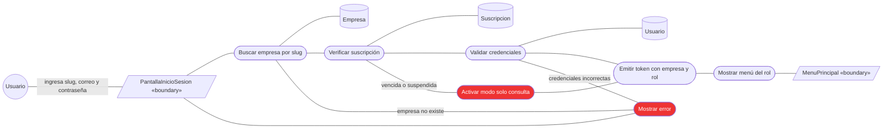

# Robustez (ICONIX) vs. comunicación (lo que hicimos en el 1er parcial)

*20/10/2026. Para Karen, antes de dibujar los 3.2 del 2do parcial.*

**Respuesta corta: sí hay diferencia.** Usan los mismos tres símbolos y las mismas reglas de
conexión, por eso la ing dice que son «casi lo mismo», y nuestros 2.2 sirven de base. Pero el
diagrama de robustez de ICONIX es **más simple y de otro nivel**:

1. no lleva mensajes numerados ni operaciones con parámetros;
2. los controladores son **verbos**, uno por acción, y no un solo «Gestor» por caso de uso;
3. lleva al lado el texto de la ficha (flujo normal y alternativos), y los alternativos se
   dibujan en el mismo diagrama, en rojo.

Si copiamos los 2.2 tal cual en el 3.2, la ing va a ver diagramas de comunicación, no de
robustez. Lo que tienen de más (números, operaciones, parámetros) **no se pierde**: es lo que
va en el **3.3 Diagramas de secuencia**.

Fuente: `docs/Metodo ICONIX - Intro.pdf` (el PDF de la materia), págs. 2-4. Donde algo viene
del libro de Rosenberg (*Use Case Driven Object Modeling with UML*), que es la referencia del
PDF, se aclara.

---

## 1. Qué dice el PDF de ICONIX

**Dónde cae la robustez en el proceso.** Fase 2, *Análisis y diseño preliminar*:

```
Requisitos ─► Modelo de dominio ─► Prototipo ─► Casos de uso (+ RF asociados)
   ─► Fichas de caso de uso ─► ROBUSTEZ ─► refinar diagrama de clases
   ─► Secuencia (sale de las fichas) ─► refinar clases otra vez ─► código y pruebas
```

- La robustez **sale de la ficha** del caso de uso. Sin ficha no hay robustez.
- **No es UML**: el PDF dice que «pertenece al proceso Iconix y tampoco forma parte del UML»
  (las fichas tampoco).
- **Para qué sirve**: «añadir nuevas relaciones a los diagramas de clase», es decir, tener un
  esqueleto de la arquitectura para refinar las clases. No sirve para mostrar el orden de
  las llamadas: eso es la secuencia, en la fase 3.

**Los tres elementos y la regla de la frase.** Frontera y entidad son **sustantivos**; el
controlador es un **verbo**. El diagrama se lee como una frase: «Índice, *muestra enlace*,
libro» = frontera, controlador, entidad.

| Símbolo | Qué es | Cómo se nombra |
|---|---|---|
| Frontera (*boundary*) | Pantalla, formulario, página, servicio externo | Sustantivo: `PaginaInicioSesion` |
| Controlador (*control*) | Una acción o cálculo del sistema | **Verbo**: `Validar credenciales`, `Mostrar menú` |
| Entidad (*entity*) | Dato que se guarda | Sustantivo del dominio: `Empresa`, `Usuario` |

**Las conexiones permitidas** (el dibujo del flujo en la pág. 3):

```
Actor ◄──► Frontera ◄──► Controlador ◄──► Entidad
                          Controlador ◄──► Controlador   (la única excepción)
```

| Conexión | ¿Vale? |
|---|---|
| Actor — Frontera | Sí |
| Frontera — Controlador | Sí |
| Controlador — Entidad | Sí |
| Controlador — Controlador | Sí (excepción explícita del PDF) |
| Actor — Controlador o Entidad | **No** |
| Frontera — Entidad | **No** |
| Frontera — Frontera | **No** |
| Entidad — Entidad | **No** |

**El ejemplo del PDF** (pág. 3, la librería):

- A la izquierda va una **nota con el texto del caso de uso**: *BASIC COURSE* y *ALTERNATE
  COURSES*.
- Los enlaces son **líneas simples**. Algunas llevan una etiqueta corta con lo que hace el
  usuario o la condición: «enter home page URL», «click link», «Book not found». **No hay
  números, ni operaciones, ni parámetros.**
- Hay **varios controladores**, todos verbos: `Display links`, `Retrieve List of Books`,
  `Display Book Details page`, `Retrieve Book Details`, `Display`. Se conectan entre sí.
- El **flujo alternativo** («Book not found») está en el mismo diagrama, con su frontera y
  su controlador **pintados de rojo**.

---

## 2. Qué hicimos en el 1er parcial (los 2.2)

Ejemplo: `comunicacion/2.2 CU-01 Registrar cliente.jpg`.

- Es un **diagrama de comunicación UML** (EA le pone el marco `sd`), con los íconos de
  robustez porque los estereotipos se llaman `boundary`, `control` y `entity` (ver
  `README.md`, «Por qué las clases de 2.2 y las de 2.3 son elementos distintos»).
- **Un solo controlador por caso de uso**: `GestorRegistro`, con todo adentro.
- **Mensajes numerados con operación y parámetros**: `1.1: enviarDatos(nombres, apellidos,
  correo, contrasena)`, `1.4: existeCorreo(correo)`, `2.1: correoYaRegistrado()`. La
  numeración sale de `PDATA4`, con grupos: el 1 es el flujo principal y el 2 los
  alternativos, en otro color.
- Una nota al pie dice qué es cada grupo. **No está el texto de la ficha.**
- Algunas acciones del sistema quedaron como mensaje hacia una entidad, cuando en robustez
  serían controladores: `validarDatos`, `hashearContrasena`, `revertirTransaccion`.

---

## 3. Comparación punto por punto

| Aspecto | Robustez ICONIX (3.2) | Nuestro 2.2 (comunicación) | ¿Cambia? |
|---|---|---|---|
| ¿Es UML? | No, es de ICONIX | Sí, comunicación UML 2.5 | Sí |
| Símbolos | Frontera, controlador, entidad, actor | Los mismos íconos | **No** |
| Reglas de conexión | Actor–F, F–C, C–E, C–C | Las cumplimos | **No** |
| Controladores | **Varios por CU, cada uno un verbo** | Uno por CU (`GestorX`) | **Sí** |
| Enlaces | Línea simple; a lo sumo una etiqueta con la acción del usuario o la condición | Mensajes numerados `1.4: operacion(param)` | **Sí** |
| Texto del caso de uso | En una nota al costado: normal y alternativos | No está | **Sí** |
| Flujos alternativos | En el mismo diagrama, en rojo | En el mismo diagrama, grupo 2 en otro color | Casi igual |
| Nivel de detalle | Análisis: qué objetos hacen falta | Ya es diseño: qué operación con qué datos | **Sí** |
| Para qué sirve | Encontrar objetos que faltan y refinar el diagrama de clases | Mostrar la interacción | Sí |
| Va antes de | La secuencia (3.3) | La secuencia | No |

**Conclusión:** los objetos (fronteras y entidades) se pueden **reutilizar** de los 2.2. Lo
que cambia es el controlador (se parte en verbos), los enlaces (sin mensajes) y que se
agrega la nota con la ficha.

---

## 4. Cómo hacer un 3.2 de robustez en EA

1. **Primero la ficha** del caso de uso (2.6 del Word). La robustez se dibuja leyendo su
   flujo normal y sus alternativos, paso por paso.
2. **Tipo de diagrama.** En EA 15, `Analysis` (UML Extended), que trae la caja de
   herramientas de robustez. Si no aparece, sirve uno de comunicación, pero **sin crear
   conectores `Collaboration`**: solo `Association` (la línea).
3. **Elementos.** Reusar las fronteras y entidades del paquete `2.2 Analizar Casos de Uso >
   Clases de Analisis` cuando ya existan; tienen el estereotipo en inglés y por eso se
   dibujan con el círculo. Los nuevos se crean con `boundary`, `control` y `entity`, en
   inglés, por la misma razón.
4. **Un controlador por verbo de la ficha**, nombrado en infinitivo y con espacios:
   `Buscar empresa por slug`, `Verificar suscripción`, `Validar credenciales`. Nada de
   `GestorX`.
5. **Enlaces sin número ni operación.** Si ayuda a leerlo, una etiqueta corta en los
   enlaces del actor («ingresa slug, correo y contraseña») o en el que abre un alternativo
   («empresa no existe»).
6. **Revisar las conexiones** contra la tabla de la sección 1. Las más fáciles de equivocar:
   frontera directo a entidad, y actor directo a controlador.
7. **Alternativos en rojo**, en el mismo diagrama: su frontera o controlador con relleno
   rojo.
8. **Nota a la izquierda** con el flujo normal y los alternativos de la ficha. Es lo que hace
   que cada objeto sea rastreable hasta un paso de la ficha.
9. **Lo que falte en el diagrama de clases** (una entidad o un controlador que no estaba)
   se anota para el 3.4. Ese es el objetivo de la robustez según el PDF.

El generador `ea-comunicacion-2-2.ps1` no sirve tal cual, porque crea mensajes
`Collaboration` con `PDATA4`. Si se quiere automatizar, hay que hacer una copia que cree
solo las `Association` y los controladores por verbo.

---

## 5. Ejemplo armado: CU-48 Iniciar sesión en una empresa

Es del Ciclo 1 y el más chico de los modificados, así que sirve de modelo.

**Ficha resumida:**
- **Flujo normal:**
  1. El usuario abre la pantalla de inicio de sesión e ingresa el slug de la empresa, su
     correo y su contraseña.
  2. El sistema busca la empresa por su slug.
  3. Verifica que tenga una suscripción vigente.
  4. Valida las credenciales del usuario dentro de esa empresa.
  5. Emite el token con la empresa y el rol, y muestra el menú de su rol.
- **Alternativos:**
  - 2a. El slug no existe → muestra «empresa no encontrada».
  - 3a. La suscripción está vencida o suspendida → entra en modo solo consulta (RN-03).
  - 4a. Las credenciales son incorrectas → muestra el error.

**Robustez** (boceto; en EA va con los íconos):



Hay que fijarse en cuatro cosas:
- No hay ningún número.
- Cada controlador es un verbo de la ficha.
- `PantallaInicioSesion` nunca toca una entidad.
- Los alternativos van en rojo, en el mismo diagrama.

---

## 6. Lo que esto cambia en el resto

- **3.3 Secuencia**: ahí sí van los mensajes con operación y parámetros, y los controladores
  de la robustez pasan a ser los objetos que reciben las llamadas. Los 2.2 del 1er parcial
  son buena base para la secuencia, más que para la robustez.
- **3.4 Clases**: se refina con lo que la robustez descubrió.
- **Orden de trabajo por caso de uso**: ficha (2.6) → robustez (3.2) → secuencia (3.3). El
  3.1 dominio va antes de todo, una vez por ciclo.
- **Regla del grupo que se mantiene** (los diagramas van al final del código): los diagramas se
  cierran sobre el código ya escrito. La robustez se puede bosquejar antes, desde la ficha,
  y ajustar al final.
